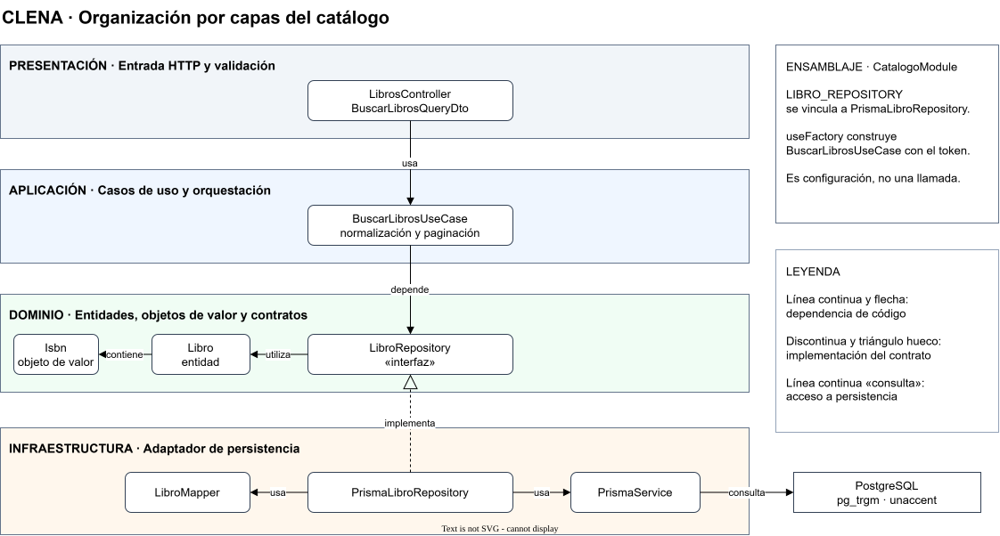

# Arquitectura de CLENA Catálogo Biblioteca

## 1. Introducción

CLENA Catálogo Biblioteca organiza la información bibliográfica, sus ejemplares y los préstamos asociados. La arquitectura separa las reglas del negocio de la interacción HTTP y de la persistencia para que cada responsabilidad pueda evolucionar y probarse con dependencias identificables.

Este informe describe la organización del sistema y las decisiones técnicas relevantes, con especial atención al módulo de catálogo y a su búsqueda bibliográfica.

## 2. Visión general de la solución

La solución está integrada por un frontend React y TypeScript, construido con Vite, y una API HTTP desarrollada con NestJS y TypeScript. El frontend utiliza Axios para las operaciones conectadas a la API, cuyo prefijo es `/api/v1`. La documentación interactiva de la API está disponible en `/docs`.

El backend utiliza Prisma Client para acceder a PostgreSQL. `AppModule` integra los módulos de autenticación, catálogo y préstamos, además de configuración, registro y salud. Docker Compose organiza la ejecución local de los servicios.

## 3. Enfoque arquitectónico

La estructura del backend adopta principios de Clean Architecture: las entidades expresan conceptos y reglas del negocio; los casos de uso coordinan operaciones; y los adaptadores externos traducen las peticiones y los datos de persistencia. En el catálogo, las entidades y los contratos de repositorio no requieren NestJS ni Prisma.

La inversión de dependencias se concreta mediante interfaces de repositorio ubicadas en el dominio. Los casos de uso dependen de esos contratos, mientras la infraestructura proporciona implementaciones con Prisma. Los módulos de NestJS ensamblan ambos extremos mediante tokens y proveedores. La organización por carpetas no reproduce literalmente todos los círculos conceptuales de Clean Architecture: presentación e infraestructura reúnen adaptadores y tecnologías externas con responsabilidades distintas.

## 4. Organización por capas

| Capa | Responsabilidad y elementos representativos | Dependencias |
|---|---|---|
| Dominio | Modela `Libro`, `Ejemplar`, `Autor` y `Tema`, el objeto de valor `Isbn` y contratos como `LibroRepository`. `Libro` valida, entre otras reglas, la existencia de autores y el enlace digital. | Utiliza tipos y errores de dominio compartidos. |
| Aplicación | Coordina operaciones mediante casos de uso como `BuscarLibrosUseCase` y sus DTOs. | Utiliza entidades y contratos del dominio. |
| Presentación | Expone HTTP mediante `LibrosController`, DTOs, validación y tratamiento de errores. | Utiliza NestJS y casos de uso. |
| Infraestructura | Implementa persistencia, mapeo, lectura CSV y registro mediante `PrismaLibroRepository`, `LibroMapper` y `PrismaService`, entre otros. | Implementa contratos de dominio y utiliza tecnologías externas. |

Presentación e infraestructura son externas al núcleo: no constituyen una cadena de dependencia lineal obligatoria. `CatalogoModule` actúa como punto de composición y conoce los contratos y las implementaciones necesarias para conectarlos. Algunas invariantes también requieren coordinación entre capas; por ejemplo, la unicidad del ISBN se comprueba en la aplicación y se protege mediante la restricción de la base de datos.

## 5. Diagrama de arquitectura por capas



**Figura 1. Organización por capas y dependencias del módulo de catálogo.**

La figura presenta una selección de elementos del catálogo y muestra cómo el caso de uso depende de un contrato de dominio. La implementación Prisma realiza ese contrato y utiliza el mapper y el cliente de persistencia. Las flechas identifican dependencias de código, realización y acceso a la base de datos; el recuadro de composición describe la configuración de NestJS, no una llamada de negocio.

La representación es un diagrama de capas, no un diagrama C4 de componentes. Su fuente editable se encuentra en [arquitectura-capas.drawio](arquitectura-capas.drawio).

## 6. Aplicación de la regla de dependencia

`LibrosController` depende de `BuscarLibrosUseCase`, y este depende estáticamente de `LibroRepository`. El contrato declara la operación `buscar` sin conocer la tecnología de persistencia. `PrismaLibroRepository` implementa el contrato y depende de `PrismaService` y `LibroMapper`. Estas relaciones corresponden al flujo de búsqueda del catálogo; no constituyen una garantía automatizada para todos los módulos.

En ejecución, `GET /api/v1/libros/buscar` pasa por el controlador y el caso de uso. NestJS resuelve el repositorio concreto según la configuración de `CatalogoModule`; el repositorio consulta PostgreSQL, reconstruye los libros y los devuelve al caso de uso. Este transforma las entidades a DTOs y retorna `items`, `total`, `pagina` y `tamano`. El flujo de ejecución alcanza la infraestructura, aunque la dependencia estática del caso de uso apunta al contrato interno.

## 7. Estructura del backend

```text
backend/
├── prisma/
│   ├── schema.prisma
│   └── migrations/
├── src/
│   ├── app.module.ts
│   ├── app.setup.ts
│   ├── main.ts
│   ├── modules/
│   │   ├── auth/
│   │   ├── catalogo/
│   │   │   ├── domain/{entities,value-objects,repositories,services}/
│   │   │   ├── application/{dtos,use-cases}/
│   │   │   ├── presentation/{controllers,dtos}/
│   │   │   ├── infrastructure/{persistence,mappers,csv}/
│   │   │   └── catalogo.module.ts
│   │   └── prestamos/
│   └── shared/{domain,infrastructure,presentation}/
└── test/
```

`modules` agrupa funcionalidades; `shared` contiene capacidades y tipos compartidos. En catálogo, los directorios corresponden a las cuatro capas y el módulo NestJS define su composición. `prisma` conserva el esquema y las migraciones; `test` contiene pruebas del backend. Las llaves representan directorios hermanos.

## 8. Inyección de dependencias

`LIBRO_REPOSITORY` es un símbolo definido junto a la interfaz `LibroRepository`. Como las interfaces TypeScript no existen en ejecución, NestJS utiliza el símbolo para identificar el proveedor. Los siguientes fragmentos pertenecen a la lista `providers` de `CatalogoModule`:

```typescript
{ provide: LIBRO_REPOSITORY, useClass: PrismaLibroRepository },
```

```typescript
{
  provide: BuscarLibrosUseCase,
  useFactory: (libros: LibroRepository) => new BuscarLibrosUseCase(libros),
  inject: [LIBRO_REPOSITORY],
},
```

La fábrica recibe la implementación registrada bajo el token y construye el caso de uso con el contrato. Esto permite sustituir el repositorio en pruebas sin modificar el caso de uso. El repositorio concreto recibe `PrismaService` mediante su constructor.

## 9. Decisiones técnicas

### 9.1. Persistencia y ORM

Prisma define los modelos y relaciones en `backend/prisma/schema.prisma` y genera un cliente tipado para PostgreSQL. Los repositorios encapsulan el acceso a datos y los mappers traducen entre registros y entidades. `PrismaLibroRepository.guardar` emplea una transacción para actualizar el libro y sus asociaciones, y traduce el conflicto de unicidad `P2002`.

Los modelos tipados, las relaciones y las transacciones resultan apropiados para libros, autores, temas y ejemplares. El compromiso es mantener mappers y SQL específico para capacidades no expresadas mediante consultas ordinarias del cliente. Las migraciones versionan el esquema e incluyen SQL para extensiones e índices; el arranque documentado con Docker aplica `prisma migrate deploy`.

### 9.2. Validación de datos

Los DTOs emplean `class-validator` para declarar restricciones, como `@IsString`, `@MinLength` y `@IsInt`, y `class-transformer` para conversiones como `@Type(() => Number)`. El `ValidationPipe` global transforma las entradas y rechaza propiedades no declaradas. Las peticiones inválidas reciben HTTP 400, con un formato normalizado por `AllExceptionsFilter`.

Esta validación delimita la entrada HTTP; el caso de uso y las entidades conservan sus propias reglas. Su principal compromiso es mantener coherentes las restricciones del transporte con las reglas internas.

### 9.3. Registro y observabilidad

`nestjs-pino` y `pino-http` integran Pino con NestJS para producir registros estructurados de peticiones. Se acepta o genera `x-request-id`, se configura el nivel mediante `LOG_LEVEL` y se excluye `/health` del registro automático. El filtro de excepciones registra errores de servidor y devuelve el identificador cuando está disponible.

La correlación por petición facilita investigar fallos del catálogo. La redacción protege las cabeceras de autorización y cookies configuradas, pero no garantiza eliminar datos sensibles incluidos en otros campos, mensajes o URL. El registro estructurado, por sí solo, no implica almacenamiento centralizado ni monitoreo.

### 9.4. Componentes de interfaz

El frontend utiliza React, componentes propios y CSS Modules. `lucide-react` aporta iconos y `@fontsource/outfit` proporciona una fuente; ninguna de las dos es una biblioteca integral de componentes. No figura una biblioteca general de componentes en las dependencias del frontend.

Los componentes propios permiten adaptar la interfaz a las necesidades del catálogo, pero el equipo debe mantener sus estilos, comportamiento y accesibilidad.

## 10. Estrategia de búsqueda tolerante a errores

La búsqueda bibliográfica pública permite consultar conjuntamente título, autor y tema mediante `GET /api/v1/libros/buscar`. `BuscarLibrosUseCase` elimina espacios extremos, compacta espacios internos y convierte la frase a minúsculas. Valida una longitud de 2 a 100 caracteres, elimina términos repetidos y conserva hasta diez términos.

### Normalización e índices

La migración inicial habilita `unaccent` y `pg_trgm`. La función `f_unaccent` envuelve `unaccent` y se declara `IMMUTABLE` para permitir índices de expresión. La consulta aplica `f_unaccent(lower(...))` tanto a los términos como a los campos de título, nombre de autor y nombre de tema, por lo que la comparación no distingue mayúsculas ni tildes.

`pg_trgm` compara secuencias de trigramas. Para términos de cuatro o más caracteres, el operador `<%` permite coincidencias aproximadas de palabra. Su umbral depende de la configuración de PostgreSQL; el valor predeterminado habitual es 0,6 y la consulta no lo fija. La función `word_similarity` calcula la similitud del término frente a una secuencia de trigramas del texto; no equivale a `similarity`, que compara los conjuntos de trigramas de ambos textos completos. Aunque `docs/modelo-datos.md` menciona `similarity()`, la consulta implementada usa `word_similarity`.

La migración crea tres índices GIN con `gin_trgm_ops` sobre las expresiones normalizadas del título, autor y tema. Estas coinciden con las expresiones usadas en la consulta. El planificador decide si los utiliza: la mejora efectiva debe evaluarse con `EXPLAIN (ANALYZE, BUFFERS)` y datos representativos. El envoltorio supone estable el diccionario de `unaccent`; un cambio de sus reglas puede requerir reconstruir los índices.

### Consulta, relevancia y paginación

El repositorio combina coincidencias por subcadena con `LIKE` y coincidencias aproximadas mediante `<%`. Cada término debe aparecer en al menos uno de los tres campos. La consulta utiliza `Prisma.sql` y `$queryRaw` parametrizados; además, escapa los comodines de `LIKE` para tratar literalmente el texto del usuario.

La puntuación suma coincidencias: título con peso 3, autor con peso 2 y tema con peso 1. Las coincidencias aproximadas se multiplican por `word_similarity`. El título recibe cinco puntos adicionales si contiene la frase completa y tres si empieza por ella. Los resultados se ordenan por relevancia descendente y, para desempatar, por título e identificador ascendentes.

El DTO admite `pagina` y `tamano` enteros positivos; el tamaño predeterminado es 20 y el máximo 100. El repositorio obtiene la página y el total mediante `LIMIT`, `OFFSET` y un conteo, y conserva el orden al reconstruir las entidades.

Por ejemplo, `garcia marquez` puede encontrar un autor llamado `García Márquez` tras eliminar las tildes. Una palabra de al menos cuatro caracteres con un error puede coincidir si supera el umbral de similitud; esto no garantiza corregir cualquier error ni reconocer sinónimos.

### Limitaciones funcionales

El endpoint tolerante acepta `q`, `pagina` y `tamano`; no combina los filtros de idioma, tipo, formato, autor, tema o año. Estos pertenecen al listado `GET /api/v1/libros`, cuyo filtro de texto usa `contains` insensible a mayúsculas solo sobre el título. Los términos posteriores al décimo se descartan, aunque la frase completa participa en las bonificaciones de relevancia.

## 11. Consideraciones y limitaciones

La pantalla React de búsqueda muestra actualmente los parámetros y un mensaje provisional. Su selector `ambito` no corresponde a un parámetro del endpoint tolerante; la integración de resultados y el comportamiento del selector requieren una decisión del equipo. También corresponde decidir si la búsqueda tolerante debe combinarse con los filtros del listado y cómo tratar consultas con más de diez términos.

La configuración de los proveedores centraliza el ensamblaje, pero no impone por sí misma la regla de dependencia en todo el repositorio. Una prueba de importación utiliza directamente `CsvParseLector` de infraestructura. Las pruebas unitarias de búsqueda emplean un repositorio falso que aproxima la semántica de PostgreSQL; existen escenarios de integración específicos para contrastar el comportamiento real del motor.

El diagrama de capas identifica responsabilidades internas del backend y puede apoyar una futura descripción C4. Para esa descripción deben confirmarse los actores, sistemas externos, contenedores, despliegue y protocolos pertinentes.

## 12. Conclusiones

La organización del catálogo separa dominio, aplicación, presentación e infraestructura. Los contratos de repositorio permiten que los casos de uso dependan de conceptos internos, mientras NestJS resuelve las implementaciones concretas durante el ensamblaje.

Prisma y PostgreSQL proporcionan persistencia relacional, transacciones y consultas especializadas. La búsqueda combina la orquestación del caso de uso con un adaptador de infraestructura que utiliza `unaccent`, trigramas e índices de PostgreSQL, manteniendo explícitas sus limitaciones funcionales.

## 13. Referencias técnicas

- [README del proyecto](../README.md) y [modelo de dominio y datos](modelo-datos.md).
- `backend/src/app.module.ts`, `backend/src/app.setup.ts` y `backend/src/main.ts`.
- `backend/src/modules/catalogo/catalogo.module.ts` y sus directorios `domain`, `application`, `presentation` e `infrastructure`.
- `backend/prisma/schema.prisma` y `backend/prisma/migrations/20261108200058_esquema_inicial/migration.sql`.
- `backend/src/shared/infrastructure/logger/logger.module.ts` y `backend/src/shared/presentation/filters/all-exceptions.filter.ts`.
- `frontend/package.json` y `frontend/src/features/busqueda/BusquedaPage.tsx`.
- `backend/src/modules/catalogo/application/use-cases/buscar-libros.use-case.spec.ts` y `backend/test/integracion/flujos.int-spec.ts`.
