# Manual de usuario: Catálogo CLENA

> **Versión:** Sprint 3  
> **Audiencia:** Personal y administración de la Biblioteca del CLENA  
> **URL del sistema:** *(pendiente)*

---

## Tabla de contenidos

1. [Acceso al sistema](#1-acceso-al-sistema)
2. [Panel de personal](#2-panel-de-personal)
3. [Gestión del catálogo](#3-gestión-del-catálogo)
4. [Gestión de ejemplares](#4-gestión-de-ejemplares)
5. [Autores](#5-autores)
6. [Temas](#6-temas)
7. [Importación masiva de libros](#7-importación-masiva-de-libros)
8. [Préstamos](#8-préstamos)
9. [Devoluciones](#9-devoluciones)
10. [Seguimiento de préstamos](#10-seguimiento-de-préstamos)
11. [Generación de código QR de acceso](#11-generación-de-código-qr-de-acceso)
12. [Gestión de usuarios (solo Administrador)](#12-gestión-de-usuarios-solo-administrador)

---

## 1. Acceso al sistema

### Ingresar
1. Abrir el navegador y dirigirse a la URL del sistema.
2. Hacer clic en **Ingresar** en la barra superior.
3. Escribir el correo electrónico y la contraseña asignados por el administrador.
4. Hacer clic en **Ingresar**.

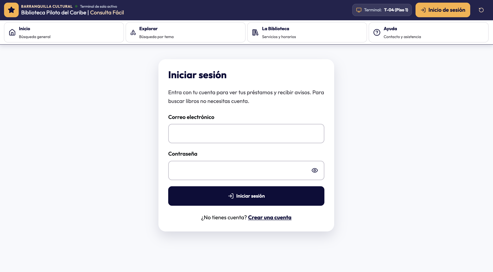

Tras ingresar, el menú superior mostrará el nombre del usuario y las opciones del panel.

### Cerrar sesión
Hacer clic en el nombre del usuario en la barra superior y seleccionar **Cerrar sesión**.

---

## 2. Panel de personal

La ruta `/panel` es el punto de entrada para todas las tareas del personal y la administración.  
Desde aquí se accede a:

- **Libros:** catálogo de títulos.
- **Autores:** listado de autores registrados.
- **Temas:** categorías temáticas del catálogo.
- **Préstamos:** registro y gestión de préstamos activos.
- **QR:** generación del código QR de acceso para terminales de consulta.
- **Importar:** carga masiva de libros desde archivo Excel.
- **Usuarios** *(solo Administrador):* gestión de cuentas y roles.

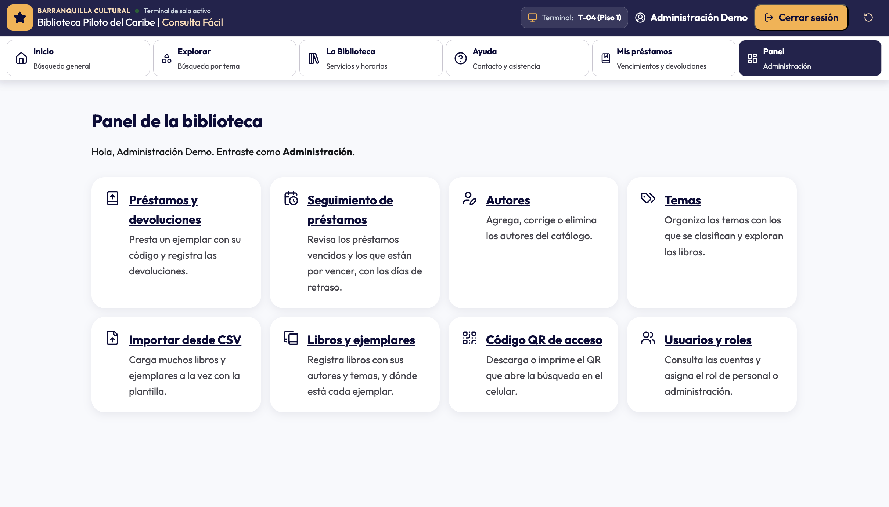
---

## 3. Gestión del catálogo

### Ver la lista de libros
1. En el panel, hacer clic en **Libros y ejemplares**.
2. Muestra un listado de título, autor(es), año y formato.
3. Usar el buscador en la parte superior para filtrar por título, año, formato o tipo de material.

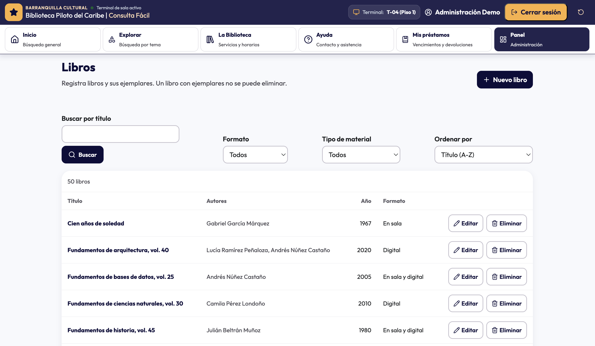

### Agregar un libro
1. En la sección **Libros** del panel, hacer clic en **Nuevo libro**.
2. Completar los campos obligatorios: **Título**, **Idioma**, **Tipo de material**, **Formato** y al menos un **Autor**.
3. Opcionalmente asignar **Temas**, **ISBN** y **Año**.
4. Hacer clic en **Guardar**.

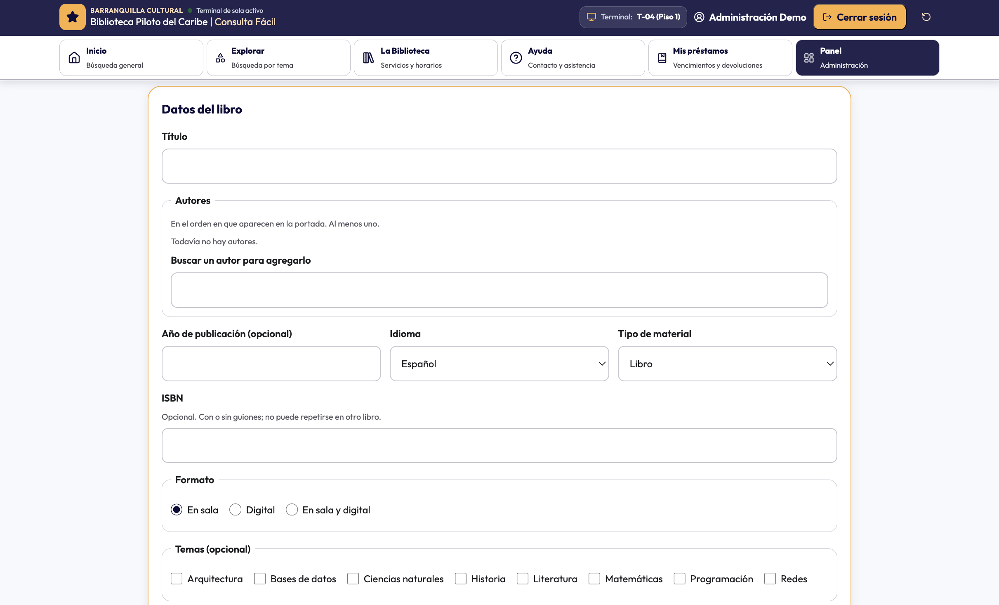

### Editar un libro
1. En el listado de libros, hacer clic sobre el ícono de editar.
2. Modificar los campos necesarios.
3. Hacer clic en **Guardar cambios**.

### Eliminar un libro
1. En el formulario de edición, hacer clic en **Eliminar**.
2. Confirmar la acción en el diálogo que aparece.

> Eliminar un libro elimina también sus ejemplares. Solo se puede eliminar si el libro no tiene préstamos activos.

---

## 4. Gestión de ejemplares

Cada libro puede tener uno o más ejemplares físicos. Los ejemplares registran la ubicación exacta (sala, sección, estante) y su estado.

### Agregar un ejemplar
1. Abrir el libro desde el panel.
2. En la sección **Ejemplares**, hacer clic en **Agregar ejemplar**.
3. Completar: **Código de inventario**, , **Ubicación**, **Sección**, **Estado** y **Observaciones**.
4. Hacer clic en **Guardar**.

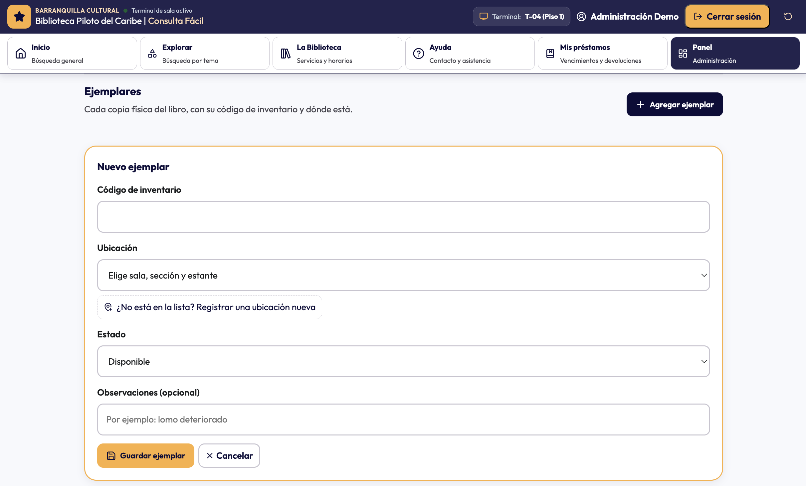

### Editar o eliminar un ejemplar
1. En la lista de ejemplares del libro, hacer clic en el ícono de edición del ejemplar deseado.
2. Modificar los campos y hacer clic en **Guardar**, o hacer clic en **Eliminar** para eliminarlo.

> No se puede eliminar un ejemplar que esté prestado.

---

## 5. Autores

### Ver autores
En el panel, hacer clic en **Autores**.

### Crear un autor
1. Hacer clic en **Nuevo autor**.
2. Ingresar el **Nombre** del autor.
3. Hacer clic en **Guardar**.

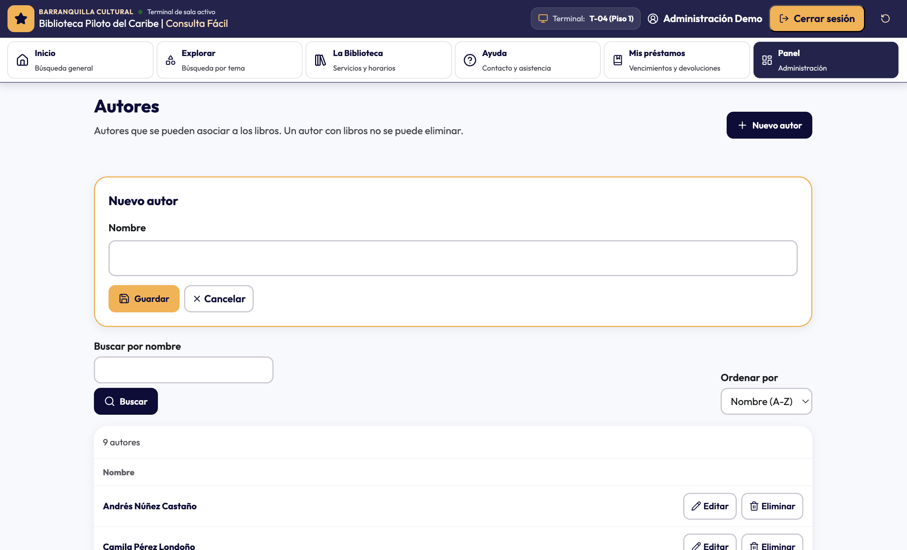

### Editar o eliminar un autor
1. En el listado, hacer clic en el ícono de edición.
2. Modificar el nombre y hacer clic en **Guardar**, o hacer clic en **Eliminar** para eliminarlo.

> No se puede eliminar un autor que tenga libros asociados.

---

## 6. Temas

Los temas son las categorías temáticas (materias) del catálogo.

### Crear un tema
1. En el panel, hacer clic en **Temas**.
2. Hacer clic en **Nuevo tema**.
3. Ingresar el **Nombre** del tema.
4. Hacer clic en **Guardar**.

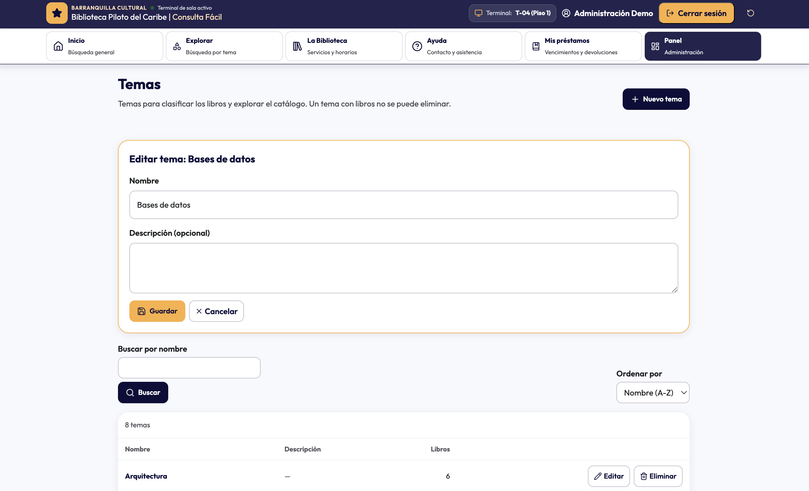

### Editar o eliminar un tema
1. En el listado, hacer clic en el ícono de edición.
2. Modificar el nombre y descripción y hacer clic en **Guardar**, o hacer clic en **Eliminar** para eliminarlo.

---

## 7. Importación masiva de libros

Permite cargar varios libros a la vez desde un archivo Excel (.xlsx).

### Pasos
1. En el panel, hacer clic en **Importar desde CSV**.
2. Descargar la **Plantilla Excel** haciendo clic en el enlace correspondiente.
3. Completar la plantilla con los datos de los libros (ver instrucciones dentro del archivo).
4. En la misma pantalla, hacer clic en **Seleccionar archivo** y elegir el archivo completado.
5. Hacer clic en **Importar**.
6. El sistema mostrará un resumen: cuántos libros se importaron correctamente y cuáles tuvieron errores (con la fila y el motivo).

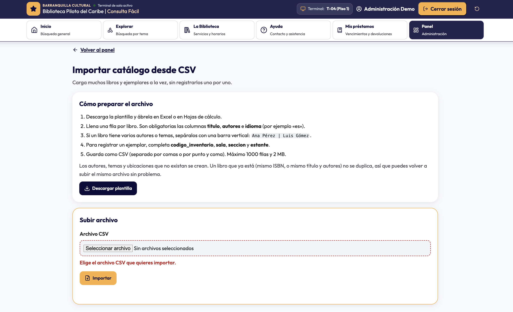

> Los libros con errores no se importan, el resto sí. Se puede corregir el archivo y reimportar solo las filas con error.

---

## 8. Préstamos

El registro de un préstamo requiere que el usuario tenga sesión iniciada en el sistema.

### Registrar un préstamo
1. En el panel, hacer clic en **Préstamos y devoluciones**.
2. Buscar el libro por código de inventario.
3. Agrega el usuario por su correo electrónico.
4. Verificar que haya ejemplares disponibles.
5. Hacer clic en **Prestar**.
6. El sistema confirmará el préstamo y mostrará la fecha de devolución esperada (por defecto, 15 días desde hoy).

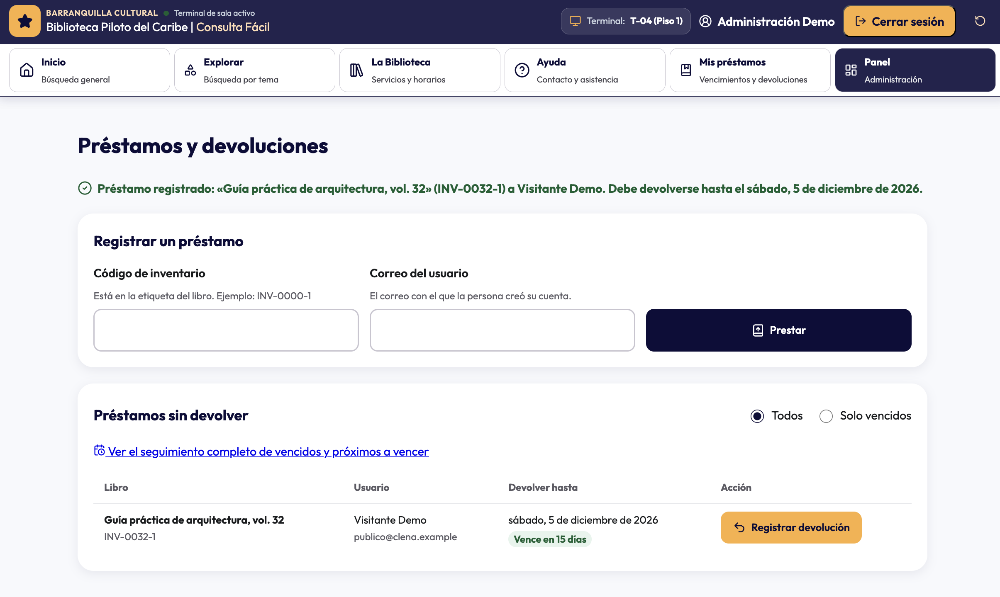

> El sistema no permite registrar un préstamo si el usuario ya tiene el número máximo de préstamos activos (por defecto 3).

---

## 9. Devoluciones

### Registrar una devolución
1. En el mismo panel de **Préstamos y devoluciones**, buscar el préstamo activo.
2. Hacer clic en **Registrar devolución** en la fila correspondiente.
3. Confirmar la acción.

Al registrar la devolución, el sistema notifica automáticamente a los usuarios que tienen una alerta de disponibilidad activa para ese libro.

---

## 10. Seguimiento de préstamos

La vista de seguimiento muestra todos los préstamos activos y los vencidos.
- **Activos:** préstamos dentro del plazo sin devolver.
- 
- **Vencidos:** préstamos cuya fecha límite ya pasó (se marcan en rojo).

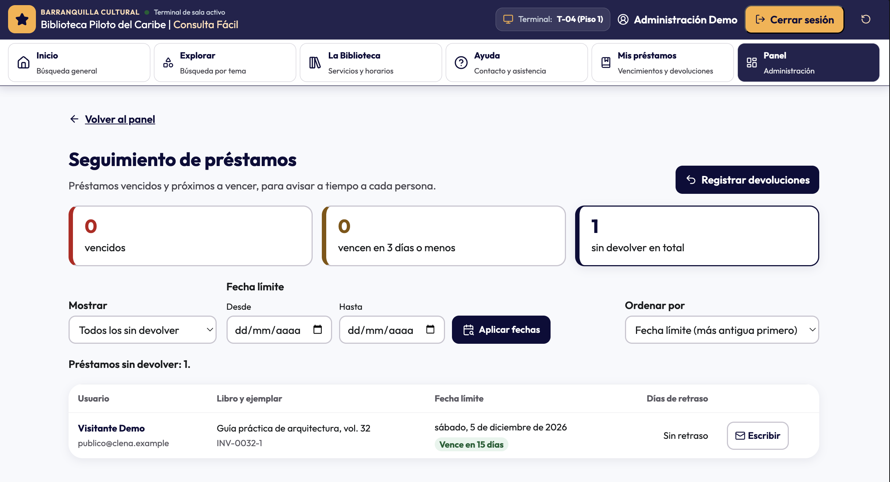

Desde esta vista también se puede registrar una devolución directamente.

---

## 11. Generación de código QR de acceso

El QR permite a los usuarios del público acceder al catálogo desde sus celulares sin necesidad de iniciar sesión.

1. En el panel, hacer clic en **Código QR de acceso**.
2. Se muestra el código QR listo para imprimir o proyectar.
3. Hacer clic en **Descargar imagen** o **Imprimir cartel** para guardar la imagen.

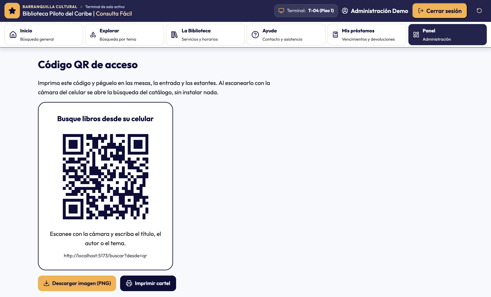

---

## 12. Gestión de usuarios (solo Administrador)

Esta sección es exclusiva del rol **ADMINISTRADOR**. En el panel, hacer clic en **Usuarios y roles** para listar todos los usuarios registrados con su nombre, correo y rol actual.

> Solo un Administrador puede otorgar o revocar el rol de personal o administrador.
