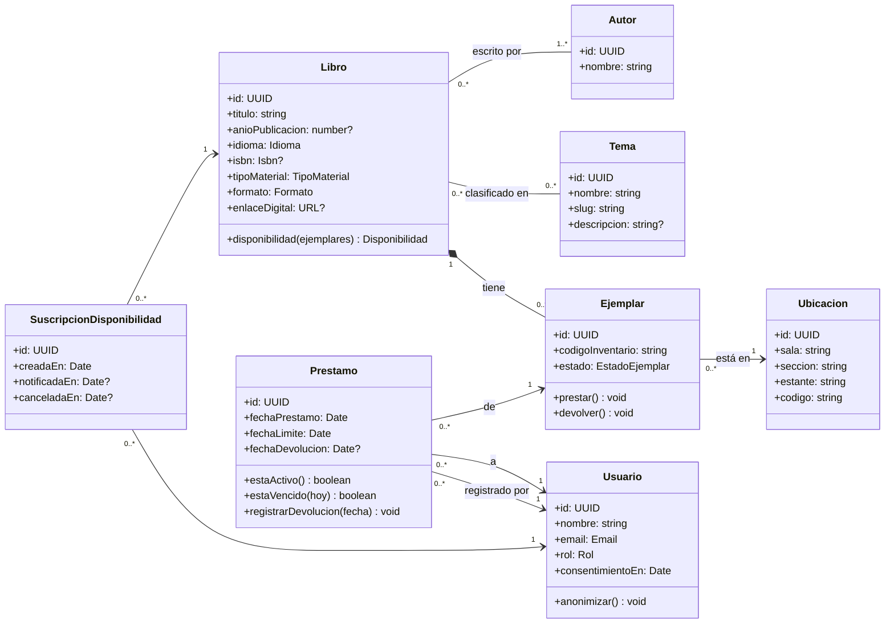
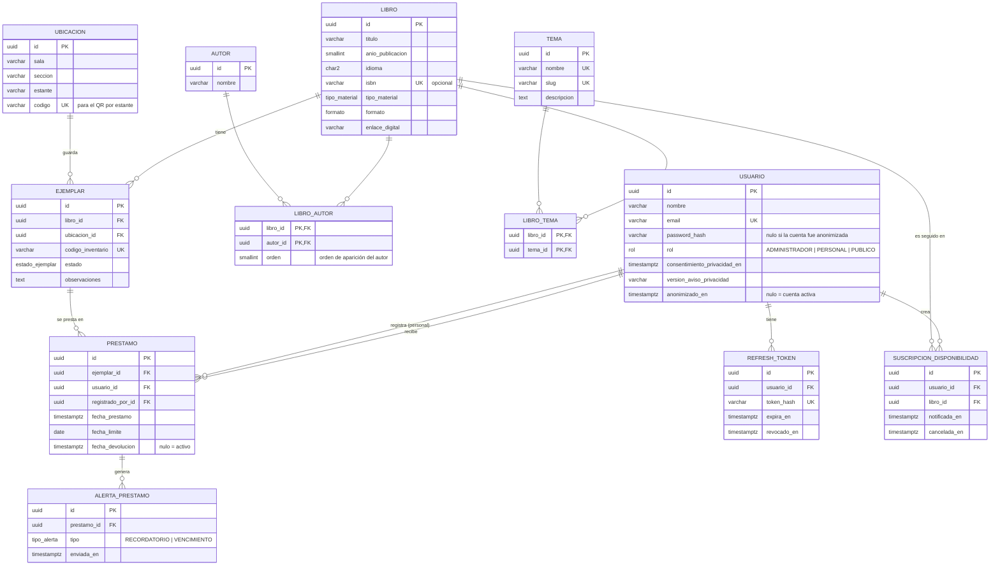

# Modelo de dominio y modelo de datos

Issue: HU-02 (#2) · Responsable: Santiago Vengoechea

Este documento define las entidades que todo el equipo implementa en el catálogo bibliográfico del CLENA: **Libro, Autor, Tema, Ejemplar, Ubicación, Préstamo y Usuario**, más las entidades de apoyo que piden otras historias (refresh tokens, alertas y suscripciones). Es la referencia para las migraciones y semillas (HU-10) y para los módulos de autenticación, catálogo, búsqueda y préstamos.

Convenciones:

- Nombres de dominio en español y en singular (`Libro`, `Ejemplar`). En Prisma, modelos en PascalCase y campos en camelCase; en PostgreSQL, tablas y columnas en snake_case (`@@map` / `@map`).
- Llaves primarias `id` de tipo UUID generadas por la base (`gen_random_uuid()`).
- Toda tabla tiene `creado_en` y `actualizado_en` (se omiten en los diagramas para no repetirlos).
- Los datos de las semillas son ficticios; no se usan datos reales del CLENA (PDF §10).

## 1. Modelo de dominio

El dominio es TypeScript puro (HU-05): estas clases no conocen Prisma ni NestJS. Los repositorios de infraestructura mapean las filas de Prisma a estas entidades.



### Enumeraciones y objetos de valor

| Tipo | Valores / regla |
|---|---|
| `Rol` | `ADMINISTRADOR`, `PERSONAL`, `PUBLICO` (HU-13) |
| `EstadoEjemplar` | `DISPONIBLE`, `PRESTADO`, `EN_REPARACION`, `PERDIDO` (HU-17) |
| `TipoMaterial` | `LIBRO`, `REVISTA`, `TESIS`, `TRABAJO_DE_GRADO`, `MATERIAL_AUDIOVISUAL`, `OTRO` (ajustable con el CLENA) |
| `Formato` | `FISICO`, `DIGITAL`, `FISICO_Y_DIGITAL` (HU-16) |
| `Idioma` | Código ISO 639-1 en minúscula (`es`, `en`, `fr`…) |
| `Isbn` | ISBN-10 o ISBN-13 normalizado sin guiones; se valida el dígito de control |
| `Email` | Se guarda en minúscula y sin espacios |
| `Disponibilidad` | Objeto calculado: `{ total, disponibles, proximaDevolucion?: Date, tieneDigital }` |

### Reglas de negocio (invariantes del dominio)

| # | Regla | Historia |
|---|---|---|
| R1 | Un libro tiene al menos un autor. | HU-16 |
| R2 | El ISBN es único cuando existe; puede faltar (material antiguo o tesis). | HU-16 |
| R3 | Si el formato es `DIGITAL` o `FISICO_Y_DIGITAL`, `enlaceDigital` es obligatorio. Un libro `DIGITAL` no tiene ejemplares. | HU-16, HU-23 |
| R4 | El código de inventario del ejemplar es único en toda la biblioteca. | HU-17 |
| R5 | La disponibilidad del libro **no se guarda**: se calcula contando sus ejemplares en estado `DISPONIBLE`. | HU-17 |
| R6 | Solo se presta un ejemplar en estado `DISPONIBLE`; al prestar pasa a `PRESTADO` y al devolver vuelve a `DISPONIBLE`. | HU-26 |
| R7 | Un ejemplar tiene como máximo un préstamo activo (`fechaDevolucion` nula). | HU-26 |
| R8 | `fechaLimite = fechaPrestamo + N días`; N es configurable (variable de entorno, por defecto 15, pendiente de confirmar con el CLENA). | HU-26 |
| R9 | Un préstamo está vencido si está activo y `hoy > fechaLimite`. El estado «vencido» se calcula, no se guarda. | HU-27, HU-36 |
| R10 | No se puede eliminar un autor con libros asociados, ni un ejemplar o usuario con historial de préstamos (se responde 409 con mensaje claro). | HU-14, HU-34 |
| R11 | El registro exige aceptar el aviso de privacidad; se guarda la fecha y la versión del aviso aceptado. | HU-11 |
| R12 | Eliminar la cuenta anonimiza al usuario (nombre y correo reemplazados, hash borrado) y conserva sus préstamos sin identificarlo. No se permite con préstamos activos. | HU-34 |
| R13 | Un usuario tiene como máximo una suscripción activa por libro; se cierra al notificarse o al cancelarse. | HU-30 |
| R14 | Cada tipo de alerta (recordatorio, vencimiento) se envía una sola vez por préstamo. | HU-29 |

## 2. Diagrama entidad-relación



## 3. Descripción de las entidades

### Usuario
Persona que usa el sistema. El registro solo pide **nombre, correo y contraseña** (dato mínimo, Ley 1581 de 2012). El rol por defecto es `PUBLICO`; solo un administrador lo cambia. La contraseña se guarda con hash (bcrypt o argon2), nunca en claro.
- `consentimiento_privacidad_en` y `version_aviso_privacidad`: prueba del consentimiento (HU-11).
- `anonimizado_en`: al eliminar la cuenta se reemplazan nombre y correo por valores neutros (`usuario-eliminado-<id>`), se borra `password_hash` y se revocan sus refresh tokens (HU-34). La fila se conserva para que los préstamos sigan siendo consistentes.

### RefreshToken
Sesiones activas de un usuario (HU-12). Se guarda el **hash** del token, no el token. El logout llena `revocado_en`. Al renovar se revoca el anterior y se emite uno nuevo (rotación).

### Autor
Persona o entidad autora. Un solo campo `nombre` con el nombre como se muestra («Gabriel García Márquez»); la búsqueda tolerante a errores trabaja sobre él. Relación muchos a muchos con Libro a través de `libro_autor`, que guarda el `orden` para mostrar los autores como en la portada.

### Tema
Categoría temática para la búsqueda por tema y la exploración por categorías (HU-15, HU-35). `slug` (por ejemplo `bases-de-datos`) se usa en las URLs. Las semillas cargan los temas propuestos por el equipo de Introducción (Arquitectura, Bases de datos, Redes, Programación…). Relación muchos a muchos con Libro a través de `libro_tema`.

### Libro
La obra bibliográfica (el «título» del catálogo), independiente de cuántas copias físicas haya. Guarda los metadatos de búsqueda y filtrado: título, año, idioma, ISBN, tipo de material y formato. Si tiene versión digital, `enlace_digital` lleva a ella (R3).

### Ejemplar
Cada copia física de un libro, identificada por su `codigo_inventario` (el código de barras o etiqueta del CLENA). Tiene una ubicación y un estado. Es lo que se presta, no el libro.

### Ubicación
Lugar físico normalizado: **sala → sección → estante** (por ejemplo «Sala 1 · Ingeniería · E-04»). La combinación `(sala, seccion, estante)` es única. `codigo` es un identificador corto e imprimible que usa el QR por estante de HU-31 (`/ubicaciones/{codigo}`). Se modela como tabla aparte y no como columnas del ejemplar para no repetir textos, poder listar «los libros de este estante» y corregir un nombre de sala en un solo lugar.

### Préstamo
Registro de que un ejemplar se entregó a un usuario. Lo crea alguien con rol `PERSONAL` o `ADMINISTRADOR` (`registrado_por_id`). Está **activo** mientras `fecha_devolucion` sea nula. El historial nunca se borra.

### AlertaPrestamo
Bitácora de los correos enviados por la tarea programada de HU-29. La restricción única `(prestamo_id, tipo)` evita enviar el mismo recordatorio dos veces si la tarea se ejecuta de nuevo.

### SuscripcionDisponibilidad
Pedido de un usuario para que le avisen cuando un libro sin ejemplares disponibles vuelva a tener uno (HU-30). Está activa mientras `notificada_en` y `cancelada_en` sean nulas.

## 4. Relaciones y reglas de borrado

| Relación | Cardinalidad | Al borrar el padre |
|---|---|---|
| Libro – Autor (`libro_autor`) | N:M, un libro con ≥ 1 autor | Borrar libro → se borran sus filas de `libro_autor`. Borrar autor con libros → **RESTRICT** (R10) |
| Libro – Tema (`libro_tema`) | N:M | Borrar libro o tema → se borran las filas de `libro_tema` (CASCADE) |
| Libro – Ejemplar | 1:N | **RESTRICT**: primero se dan de baja los ejemplares |
| Ubicación – Ejemplar | 1:N | **RESTRICT** |
| Ejemplar – Préstamo | 1:N (máx. 1 activo) | **RESTRICT** (el historial se conserva) |
| Usuario – Préstamo (usuario y registrado_por) | 1:N | **RESTRICT** (se anonimiza, no se borra) |
| Usuario – RefreshToken | 1:N | CASCADE |
| Préstamo – AlertaPrestamo | 1:N | CASCADE |
| Usuario / Libro – SuscripcionDisponibilidad | 1:N | CASCADE |

## 5. Índices

### Columnas de búsqueda (HU-20, HU-21)

La búsqueda simple consulta **título del libro, nombre del autor y nombre del tema** con tolerancia a errores de escritura y sin distinguir tildes. Se usan las extensiones `pg_trgm` y `unaccent` de PostgreSQL con índices GIN de trigramas:

| Tabla | Columna | Índice | Para qué |
|---|---|---|---|
| `libro` | `titulo` | GIN `gin_trgm_ops` sobre `f_unaccent(lower(titulo))` | «cien anos soledad» → «Cien años de soledad» |
| `autor` | `nombre` | GIN `gin_trgm_ops` sobre `f_unaccent(lower(nombre))` | «garcia marques» → «García Márquez» |
| `tema` | `nombre` | GIN `gin_trgm_ops` sobre `f_unaccent(lower(nombre))` | búsqueda por tema |
| `libro` | `isbn` | Único (B-tree) | búsqueda exacta por ISBN y no duplicar en la importación CSV (HU-19) |

`unaccent()` no es `IMMUTABLE`, así que PostgreSQL no permite usarla directamente en un índice. Se crea una función envoltorio y las consultas deben usar **exactamente la misma expresión** para que el índice se aproveche:

```sql
CREATE EXTENSION IF NOT EXISTS pg_trgm;
CREATE EXTENSION IF NOT EXISTS unaccent;

CREATE OR REPLACE FUNCTION f_unaccent(text) RETURNS text
  LANGUAGE sql IMMUTABLE PARALLEL SAFE STRICT
  AS $$ SELECT public.unaccent('public.unaccent'::regdictionary, $1) $$;

CREATE INDEX libro_titulo_trgm_idx ON libro USING gin (f_unaccent(lower(titulo)) gin_trgm_ops);
CREATE INDEX autor_nombre_trgm_idx ON autor USING gin (f_unaccent(lower(nombre)) gin_trgm_ops);
CREATE INDEX tema_nombre_trgm_idx  ON tema  USING gin (f_unaccent(lower(nombre)) gin_trgm_ops);
```

Prisma no genera índices de expresión ni extensiones desde `schema.prisma`, así que este SQL va en una migración creada con `prisma migrate dev --create-only` y editada a mano (HU-10). La consulta de búsqueda se implementa en el repositorio de infraestructura con `$queryRaw`, ordenando por `similarity()` para la relevancia (HU-20).

### Filtros, ordenamiento y llaves foráneas (HU-22, HU-26, HU-29)

| Tabla | Columnas | Tipo | Para qué |
|---|---|---|---|
| `libro` | `idioma`, `tipo_material`, `anio_publicacion` | B-tree (uno por columna) | filtros de la búsqueda y orden por año |
| `ejemplar` | `(libro_id, estado)` | B-tree | contar disponibles por libro (R5) y filtro «disponible» |
| `ejemplar` | `ubicacion_id` | B-tree | libros de un estante (QR, HU-31) |
| `ejemplar` | `codigo_inventario` | Único | R4 |
| `ubicacion` | `(sala, seccion, estante)` y `codigo` | Únicos | evitar ubicaciones repetidas |
| `libro_autor`, `libro_tema` | `autor_id`, `tema_id` | B-tree | la PK compuesta empieza por `libro_id`; hace falta el índice inverso para «libros de un autor/tema» |
| `prestamo` | `ejemplar_id` **WHERE `fecha_devolucion IS NULL`** | Único parcial | R7: un solo préstamo activo por ejemplar |
| `prestamo` | `fecha_limite` WHERE `fecha_devolucion IS NULL` | B-tree parcial | préstamos vencidos o por vencer (HU-29, HU-36) |
| `prestamo` | `usuario_id` | B-tree | «mis préstamos» (HU-27) |
| `alerta_prestamo` | `(prestamo_id, tipo)` | Único | R14 |
| `suscripcion_disponibilidad` | `(usuario_id, libro_id)` WHERE activa | Único parcial | R13 |
| `usuario` | `email` | Único | inicio de sesión |
| `refresh_token` | `token_hash` | Único | validar el refresh token |

Los índices parciales también van en SQL a mano dentro de la migración, porque Prisma no los expresa en el esquema.

## 6. Esquema Prisma de referencia

Punto de partida para `backend/prisma/schema.prisma` en HU-10; quien tome esa historia puede ajustarlo y debe actualizar este documento si cambia el modelo.

```prisma
generator client {
  provider        = "prisma-client-js"
  previewFeatures = ["postgresqlExtensions"]
}

datasource db {
  provider   = "postgresql"
  url        = env("DATABASE_URL")
  extensions = [pg_trgm, unaccent]
}

enum Rol {
  ADMINISTRADOR
  PERSONAL
  PUBLICO
}

enum EstadoEjemplar {
  DISPONIBLE
  PRESTADO
  EN_REPARACION
  PERDIDO
}

enum TipoMaterial {
  LIBRO
  REVISTA
  TESIS
  TRABAJO_DE_GRADO
  MATERIAL_AUDIOVISUAL
  OTRO
}

enum Formato {
  FISICO
  DIGITAL
  FISICO_Y_DIGITAL
}

enum TipoAlerta {
  RECORDATORIO
  VENCIMIENTO
}

model Usuario {
  id                         String    @id @default(dbgenerated("gen_random_uuid()")) @db.Uuid
  nombre                     String    @db.VarChar(120)
  email                      String    @unique @db.VarChar(254)
  passwordHash               String?   @map("password_hash")
  rol                        Rol       @default(PUBLICO)
  consentimientoPrivacidadEn DateTime  @map("consentimiento_privacidad_en") @db.Timestamptz
  versionAvisoPrivacidad     String    @map("version_aviso_privacidad") @db.VarChar(20)
  anonimizadoEn              DateTime? @map("anonimizado_en") @db.Timestamptz
  creadoEn                   DateTime  @default(now()) @map("creado_en") @db.Timestamptz
  actualizadoEn              DateTime  @updatedAt @map("actualizado_en") @db.Timestamptz

  prestamos            Prestamo[]                  @relation("PrestamoUsuario")
  prestamosRegistrados Prestamo[]                  @relation("PrestamoRegistradoPor")
  refreshTokens        RefreshToken[]
  suscripciones        SuscripcionDisponibilidad[]

  @@map("usuario")
}

model RefreshToken {
  id         String    @id @default(dbgenerated("gen_random_uuid()")) @db.Uuid
  usuarioId  String    @map("usuario_id") @db.Uuid
  tokenHash  String    @unique @map("token_hash")
  expiraEn   DateTime  @map("expira_en") @db.Timestamptz
  revocadoEn DateTime? @map("revocado_en") @db.Timestamptz
  creadoEn   DateTime  @default(now()) @map("creado_en") @db.Timestamptz

  usuario Usuario @relation(fields: [usuarioId], references: [id], onDelete: Cascade)

  @@index([usuarioId])
  @@map("refresh_token")
}

model Autor {
  id            String   @id @default(dbgenerated("gen_random_uuid()")) @db.Uuid
  nombre        String   @db.VarChar(200)
  creadoEn      DateTime @default(now()) @map("creado_en") @db.Timestamptz
  actualizadoEn DateTime @updatedAt @map("actualizado_en") @db.Timestamptz

  libros LibroAutor[]

  @@map("autor")
}

model Tema {
  id            String   @id @default(dbgenerated("gen_random_uuid()")) @db.Uuid
  nombre        String   @unique @db.VarChar(120)
  slug          String   @unique @db.VarChar(120)
  descripcion   String?
  creadoEn      DateTime @default(now()) @map("creado_en") @db.Timestamptz
  actualizadoEn DateTime @updatedAt @map("actualizado_en") @db.Timestamptz

  libros LibroTema[]

  @@map("tema")
}

model Libro {
  id              String       @id @default(dbgenerated("gen_random_uuid()")) @db.Uuid
  titulo          String       @db.VarChar(300)
  anioPublicacion Int?         @map("anio_publicacion") @db.SmallInt
  idioma          String       @db.Char(2)
  isbn            String?      @unique @db.VarChar(13)
  tipoMaterial    TipoMaterial @default(LIBRO) @map("tipo_material")
  formato         Formato      @default(FISICO)
  enlaceDigital   String?      @map("enlace_digital") @db.VarChar(500)
  creadoEn        DateTime     @default(now()) @map("creado_en") @db.Timestamptz
  actualizadoEn   DateTime     @updatedAt @map("actualizado_en") @db.Timestamptz

  autores       LibroAutor[]
  temas         LibroTema[]
  ejemplares    Ejemplar[]
  suscripciones SuscripcionDisponibilidad[]

  @@index([idioma])
  @@index([tipoMaterial])
  @@index([anioPublicacion])
  @@map("libro")
}

model LibroAutor {
  libroId String @map("libro_id") @db.Uuid
  autorId String @map("autor_id") @db.Uuid
  orden   Int    @default(1) @db.SmallInt

  libro Libro @relation(fields: [libroId], references: [id], onDelete: Cascade)
  autor Autor @relation(fields: [autorId], references: [id], onDelete: Restrict)

  @@id([libroId, autorId])
  @@index([autorId])
  @@map("libro_autor")
}

model LibroTema {
  libroId String @map("libro_id") @db.Uuid
  temaId  String @map("tema_id") @db.Uuid

  libro Libro @relation(fields: [libroId], references: [id], onDelete: Cascade)
  tema  Tema  @relation(fields: [temaId], references: [id], onDelete: Cascade)

  @@id([libroId, temaId])
  @@index([temaId])
  @@map("libro_tema")
}

model Ubicacion {
  id            String   @id @default(dbgenerated("gen_random_uuid()")) @db.Uuid
  sala          String   @db.VarChar(60)
  seccion       String   @db.VarChar(60)
  estante       String   @db.VarChar(30)
  codigo        String   @unique @db.VarChar(30)
  creadoEn      DateTime @default(now()) @map("creado_en") @db.Timestamptz
  actualizadoEn DateTime @updatedAt @map("actualizado_en") @db.Timestamptz

  ejemplares Ejemplar[]

  @@unique([sala, seccion, estante])
  @@map("ubicacion")
}

model Ejemplar {
  id               String         @id @default(dbgenerated("gen_random_uuid()")) @db.Uuid
  libroId          String         @map("libro_id") @db.Uuid
  ubicacionId      String         @map("ubicacion_id") @db.Uuid
  codigoInventario String         @unique @map("codigo_inventario") @db.VarChar(40)
  estado           EstadoEjemplar @default(DISPONIBLE)
  observaciones    String?
  creadoEn         DateTime       @default(now()) @map("creado_en") @db.Timestamptz
  actualizadoEn    DateTime       @updatedAt @map("actualizado_en") @db.Timestamptz

  libro     Libro      @relation(fields: [libroId], references: [id], onDelete: Restrict)
  ubicacion Ubicacion  @relation(fields: [ubicacionId], references: [id], onDelete: Restrict)
  prestamos Prestamo[]

  @@index([libroId, estado])
  @@index([ubicacionId])
  @@map("ejemplar")
}

model Prestamo {
  id              String    @id @default(dbgenerated("gen_random_uuid()")) @db.Uuid
  ejemplarId      String    @map("ejemplar_id") @db.Uuid
  usuarioId       String    @map("usuario_id") @db.Uuid
  registradoPorId String    @map("registrado_por_id") @db.Uuid
  fechaPrestamo   DateTime  @default(now()) @map("fecha_prestamo") @db.Timestamptz
  fechaLimite     DateTime  @map("fecha_limite") @db.Date
  fechaDevolucion DateTime? @map("fecha_devolucion") @db.Timestamptz
  creadoEn        DateTime  @default(now()) @map("creado_en") @db.Timestamptz
  actualizadoEn   DateTime  @updatedAt @map("actualizado_en") @db.Timestamptz

  ejemplar      Ejemplar         @relation(fields: [ejemplarId], references: [id], onDelete: Restrict)
  usuario       Usuario          @relation("PrestamoUsuario", fields: [usuarioId], references: [id], onDelete: Restrict)
  registradoPor Usuario          @relation("PrestamoRegistradoPor", fields: [registradoPorId], references: [id], onDelete: Restrict)
  alertas       AlertaPrestamo[]

  @@index([usuarioId])
  @@index([ejemplarId])
  @@map("prestamo")
}

model AlertaPrestamo {
  id         String     @id @default(dbgenerated("gen_random_uuid()")) @db.Uuid
  prestamoId String     @map("prestamo_id") @db.Uuid
  tipo       TipoAlerta
  enviadaEn  DateTime   @default(now()) @map("enviada_en") @db.Timestamptz

  prestamo Prestamo @relation(fields: [prestamoId], references: [id], onDelete: Cascade)

  @@unique([prestamoId, tipo])
  @@map("alerta_prestamo")
}

model SuscripcionDisponibilidad {
  id           String    @id @default(dbgenerated("gen_random_uuid()")) @db.Uuid
  usuarioId    String    @map("usuario_id") @db.Uuid
  libroId      String    @map("libro_id") @db.Uuid
  notificadaEn DateTime? @map("notificada_en") @db.Timestamptz
  canceladaEn  DateTime? @map("cancelada_en") @db.Timestamptz
  creadoEn     DateTime  @default(now()) @map("creado_en") @db.Timestamptz

  usuario Usuario @relation(fields: [usuarioId], references: [id], onDelete: Cascade)
  libro   Libro   @relation(fields: [libroId], references: [id], onDelete: Cascade)

  @@index([libroId])
  @@map("suscripcion_disponibilidad")
}
```

SQL que se agrega a mano en la misma migración (además del de la sección 5):

```sql
-- R7: un solo préstamo activo por ejemplar
CREATE UNIQUE INDEX prestamo_ejemplar_activo_uq ON prestamo (ejemplar_id) WHERE fecha_devolucion IS NULL;
-- Préstamos activos por fecha límite (alertas y vencidos)
CREATE INDEX prestamo_activo_fecha_limite_idx ON prestamo (fecha_limite) WHERE fecha_devolucion IS NULL;
-- R13: una suscripción activa por usuario y libro
CREATE UNIQUE INDEX suscripcion_activa_uq ON suscripcion_disponibilidad (usuario_id, libro_id)
  WHERE notificada_en IS NULL AND cancelada_en IS NULL;
-- R3: libro digital requiere enlace
ALTER TABLE libro ADD CONSTRAINT libro_enlace_digital_ck
  CHECK (formato = 'FISICO' OR enlace_digital IS NOT NULL);
```

## 7. Pendientes por confirmar con el CLENA

Vienen de las preguntas abiertas del acta de Inception (`docs/actas/inception.md`). Ninguna cambia la estructura; solo valores o semillas.

| Pregunta | Qué afecta del modelo | Supuesto mientras tanto |
|---|---|---|
| ¿Cómo se organiza físicamente la biblioteca y qué códigos usan? | Valores de `ubicacion` y formato de `codigo` | Sala → sección → estante con códigos inventados en las semillas |
| ¿Cuántos días dura un préstamo? | N de R8 | 15 días, configurable por variable de entorno |
| ¿Qué categorías temáticas usan? | Semillas de `tema` | Las de la propuesta del equipo de Introducción; temas sin jerarquía |
| ¿Pueden compartir una muestra del catálogo? | Columnas de la plantilla CSV (HU-19) y valores de `tipo_material` | Columnas = campos de `libro` + `codigo_inventario` + ubicación |
